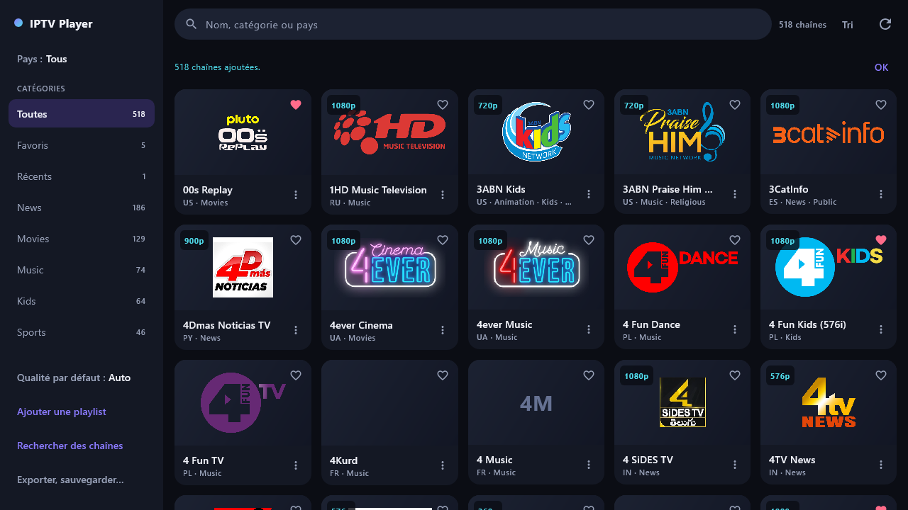

# IPTV Player

Lecteur de chaînes TV pour **Android, Android TV et Windows**, écrit en Kotlin avec Compose Multiplatform.
L'application lit des playlists M3U, teste chaque flux et ne garde que les chaînes qui répondent.



Une vidéo de présentation est disponible : [presentation/iptv-player-presentation.mp4](presentation/iptv-player-presentation.mp4).

## Télécharger

Les versions prêtes à installer sont sur la page [Releases](https://github.com/kingatal01/iptv/releases) :

| Fichier | Pour |
|---|---|
| `IPTV-Player-1.0.0.apk` | Android 9 et plus, Android TV |
| `IPTV-Player-1.0.0-installeur.msi` | Windows 64 bits, installation classique |
| `IPTV-Player-1.0.0-portable.zip` | Windows 64 bits, sans installation |

Les fichiers ne sont pas signés par un éditeur reconnu : Android demande d'autoriser les sources inconnues, et Windows
affiche un avertissement (« Informations complémentaires », puis « Exécuter quand même »).

## Fonctions

- **Import** par adresse ou par fichier (`.m3u`, `.m3u8`, `.tvlist`), avec vérification de chaque flux.
- **Bibliothèque** persistante : favoris ordonnables, chaînes récentes, renommage, suppression annulable.
- **Filtres** par catégorie, pays et langue, tri, recherche.
- **Lecteur** : choix de la qualité et de la piste audio, plein écran, image dans l'image (Android),
  reconnexion automatique, raccourcis clavier (desktop).
- **Liste par défaut** de 1 523 chaînes, importable catégorie par catégorie.
- **Recherche automatique** de chaînes par langue et mots-clés, en mode rapide ou lent, dans des index publics
  (iptv-org, Free-TV) et sur le web (DuckDuckGo, Brave, Yahoo, GitHub, GitLab).
- **Export** au format `.tvlist` par catégories, export M3U, sauvegarde complète.

## Avertissement

L'application ne fournit aucun contenu : elle lit des listes publiques. La recherche web peut ramener des chaînes
diffusées sans autorisation. Chaque utilisateur est responsable de ce qu'il ajoute et regarde, selon la loi de son pays.
La recherche de contenu pour adultes est verrouillée par un code.

## Compiler

Il faut un JDK 17 et le SDK Android (plateforme 36). Indiquez le chemin du SDK dans `local.properties` :

```
sdk.dir=C\:\\chemin\\vers\\Android\\Sdk
```

```bash
# Lancer la version desktop
./gradlew :composeApp:run

# Tests
./gradlew :composeApp:desktopTest

# APK de test
./gradlew :composeApp:assembleDebug

# Application Windows et installeur
./gradlew :composeApp:createDistributable :composeApp:packageMsi
```

La version Android de production (`assembleRelease`) est signée si un fichier `keystore.properties` est présent à la
racine ; sans lui, l'APK est produit non signé. La clé de signature du projet n'est pas dans le dépôt.

## Organisation du code

| Dossier | Contenu |
|---|---|
| `composeApp/src/commonMain` | Interface, bibliothèque, lecture des playlists, scan et recherche (code partagé) |
| `composeApp/src/androidMain` | Lecteur Media3, image dans l'image, sélecteurs de fichiers Android |
| `composeApp/src/desktopMain` | Lecteur FFmpeg, fenêtre, sélecteurs de fichiers desktop |
| `composeApp/src/commonTest` | Tests automatiques |
| `presentation` | Captures, vidéo et outils de montage |

## Contribuer

Les contributions sont les bienvenues : corrections, améliorations, nouvelles langues, nouvelles sources.

1. Ouvrez une *issue* pour décrire le problème ou l'idée.
2. Créez une branche à partir de `main` et faites vos modifications.
3. Vérifiez que `./gradlew :composeApp:desktopTest` passe et que les deux cibles compilent.
4. Ouvrez une *pull request* en expliquant ce qui change et comment vous l'avez testé.

Pistes ouvertes : sous-titres, guide des programmes, navigation complète à la télécommande sur Android TV,
démarrage plus rapide du lecteur desktop, test sur un appareil Android 9.
